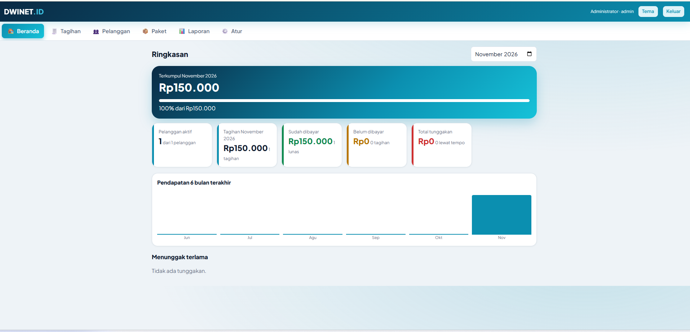

# Billing-Tagihan-Wifi-2026-Full-Fitur
Billing WIfi

DWINET.ID - Tagihan WiFi (versi database MySQL)

Kebutuhan: hosting PHP 7.4+ dengan MySQL/MariaDB (cPanel biasa sudah cukup). Disarankan pakai HTTPS.

PASANG
1. Buat database MySQL di hosting, lalu impor schema.sql lewat phpMyAdmin.
2. Isi config.php dengan nama database, user, dan password Anda.
3. Unggah index.html, api.php, dan config.php ke satu folder (misalnya public_html/tagihan).
4. Buka alamatnya. Login pertama kali MEMBUAT akun admin dari username dan password yang Anda ketik,
   jadi lakukan segera setelah pasang sebelum orang lain membukanya.
5. Di menu Atur, tambah akun penagih, lalu tugaskan penagih pada tiap pelanggan.

FILE
- schema.sql  : tabel settings, users, packages, customers, invoices, expenses
- api.php     : login (password di-hash), sesi, dan penyimpanan ke MySQL
- index.html  : tampilan aplikasi
- config.php  : koneksi database (jangan dibagikan)

CATATAN
- Penagih hanya menerima data pelanggannya dan hanya bisa mencatat pembayaran. Aturan ini dijaga di server.
- Menu Atur > Unduh cadangan .sql menghasilkan file INSERT untuk semua tabel.
- Lindungi config.php dari akses publik sesuai pengaturan hosting Anda.
